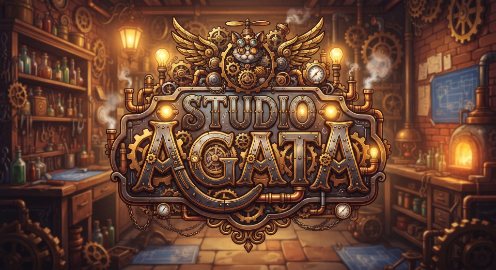

# CatWalk 🐱📱

Стилизованная 3D-игра про котика, бродящего по лужайке и собирающего золотые монетки. Разработана на движке **Unity 6 (URP)** под мобильные устройства (Android) и ПК.



## Особенности игры:
- 🐱 **Процедурный котик**: Стилизованная 3D-модель (туловище, лапки, голова с ушками, глазками и носиком, хвост), которая плавно покачивается при ходьбе как единое целое.
- 🐾 **Автономное блуждание и тапы**: Котик самостоятельно исследует лужайку (`CatWander`), а при клике/тапе в любую точку бежит к ней с отметкой маркера (`TapToMove`).
- 🪙 **Вертикальные золотые монетки**: Монетки стоят ребром, плавно парят и вращаются вокруг своей оси (`Coin`), ожидая сбора.
- ⚡ **Генератор монет**: Спавнер (`CoinSpawner`) автоматически поддерживает на лужайке 10 монеток в случайных точках, избегая спавна прямо под котиком.
- 🏆 **Счётчик очков**: UI на базе TextMeshPro (`ScoreManager`) отображает количество собранных монет в реальном времени.
- ⚙️ **Стимпанк-заставка**: Кинематографичный стартовый экран **STUDIO AGATA** с плавным затуханием (Fade Out).
- 📱 **Кроссплатформенное управление**: Поддержка нового **Input System Package** и тапов на смартфонах/планшетах без конфликтов.

## Структура проекта:
```
Assets/
├── Editor/
│   └── CatWalkSceneBuilder.cs       # 1-клик сборка всей сцены и быстрая настройка под Android
├── Materials/                       # Материалы (лужайка, шерсть котика, золото монет)
├── Prefabs/
│   ├── Coin.prefab                  # Префаб вертикальной монетки с коллайдером
│   └── TapMarker.prefab             # Маркер точки тапа
├── Scenes/
│   └── SampleScene.unity            # Игровая сцена
├── Scripts/
│   ├── CatWander.cs                 # Автономное блуждание и покачивание
│   ├── CatDirectControl.cs          # Прямое управление через джойстик
│   ├── TapToMove.cs                 # Перемещение по тапу (New Input System)
│   ├── Coin.cs                      # Поведение монетки (вращение, сбор, эффект)
│   ├── CoinSpawner.cs               # Процедурный спавн монет
│   ├── ScoreManager.cs              # Менеджер очков и UI
│   ├── SplashScreenController.cs    # Управление стартовой заставкой (3 сек)
│   ├── CameraFollow.cs              # Плавное следование камеры
│   └── ScreenAwake.cs               # Предотвращение засыпания экрана
└── Textures/
    └── StudioAgata_Splash.jpg       # Заставка Studio Agata
```

## Управление:
- **Клик / Тап по земле**: направить котика в указанную точку.
- **В режиме джойстика**: прямое перемещение стиком.
